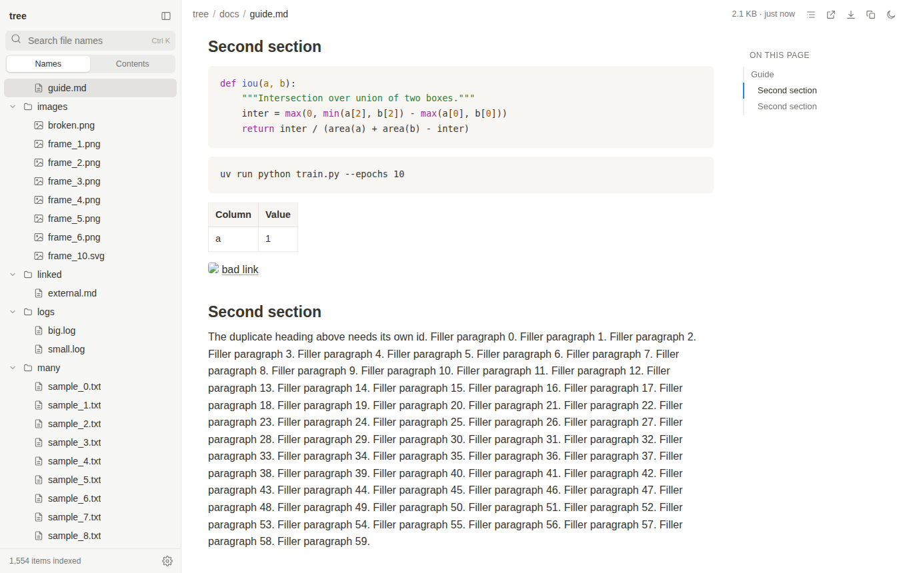
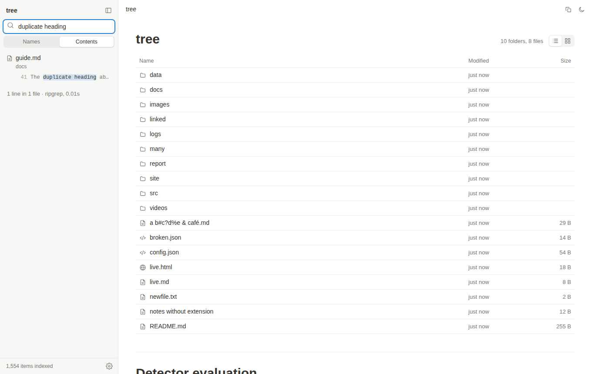

# Bunko

**A read-only file server that renders what it serves.** Point it at a folder
and open it in a browser: Markdown, HTML reports, Word documents, Excel
workbooks, CSV and JSONL tables, images, video, PDFs, code, and logs all open
in place, with the folder tree and search in a sidebar. It's a drop-in
replacement for `python -m http.server`, with no dependencies beyond Python.

*Bunko* (文庫) is Japanese for a small library, or a collection of books.


It's built for reading files where they live, usually on a remote machine:

- **Results and reports** from experiments, training runs, and pipelines:
  plots, tables, logs, videos, and HTML reports, without copying anything back.
- **Plans, notes, and reports written by AI coding agents** such as Claude Code.
  They render as they're written, and stay on your own machine.
- **A shared, read-only document folder** for a small team, with search and
  personal favorites and tags.

## Launch it

### 1. Install

Python 3.8 or later. Nothing else is required.

```bash
uv tool install git+https://github.com/ivanfarevalo/bunko
# or
pipx install git+https://github.com/ivanfarevalo/bunko
```

On a machine where you can't install anything, copy one file instead:

```bash
python3 scripts/build_pyz.py        # in a clone; writes dist/bunko.pyz
scp dist/bunko.pyz server:
ssh server python3 bunko.pyz 8099   # same options as the bunko command
```

### 2. Start it

```bash
bunko                  # serve the current folder on port 8000, or the next free one
bunko 8099 ~/reports   # choose the port and the folder
```

Bunko prints the address to open, then serves until you press `Ctrl+C`.

### 3. Open it

| Where Bunko runs | How to open it |
|---|---|
| Your own machine | Open the printed `http://localhost:8000/` |
| A remote machine, just for you | `bunko 8099 ~/reports -b 127.0.0.1` there, then `ssh -L 8099:localhost:8099 server` here, and open `http://localhost:8099/` |
| A remote machine, for named people on your tailnet (recommended) | See [Security](#security) below |
| A remote machine, behind a password-like token | `bunko 8099 ~/reports --token`, then open the link it prints |

### 4. Keep it running (optional)

```bash
tmux new-session -d -s bunko 'bunko 8099 ~/reports'             # in tmux
bunko service install --name reports -- 8099 ~/reports          # as a systemd user service
```

[docs/deployment.md](docs/deployment.md) covers both, plus the optional tools
that add thumbnails (ffmpeg) and fast content search (ripgrep).

## Features

- **Recent files, favorites, and tags** pinned at the top of the sidebar, each
  tag with its own section. They're kept on the server, so they follow you
  between devices.
- **Folder tree and search.** Find files by name (`Ctrl+K`) or search inside
  them (`Ctrl+Shift+F`, with [ripgrep](https://github.com/BurntSushi/ripgrep)
  when installed). Content results open the file at the matching line.
- **Markdown.** GitHub-flavored, with highlighted code, working relative links
  and images, and an optional outline beside the page.
- **HTML pages** render with their own CSS, scripts, and relative assets, as
  under `http.server`.
- **Images and galleries,** with thumbnails generated by ffmpeg and cached.
- **Video with review tools:** frame stepping, exact frame numbers from
  ffprobe, speed control, and links to an exact moment (`?t=12.345`).
- **CSV, TSV, and JSONL tables.** Virtualized, sortable, filterable, and
  loaded in pieces, so large files open instantly.
- **Word and Excel.** `.docx` files open as pages, with headings, lists,
  tables, images, and footnotes. `.xlsx` sheets open as tables with Excel's
  row numbers and a tab per sheet. No Office or extra packages needed.
- **Code and logs** with highlighting and line numbers. Large files load in steps.
- **Live reload.** The open file refreshes when it changes on disk.
- **Access control.** Tailscale identity (recommended) or an access token.
- **Runs anywhere:** foreground, tmux, or a systemd user service.

| | |
|---|---|
|  |  |
|  |  |

## Security

Bunko never changes the folder it serves, hides dotfiles (including through
symlinks), and refuses path tricks. **By default, though, anyone who can reach the port can read the
folder,** just as with `http.server`. Choose an access mode:

| Setup | Who gets in | Transport |
|---|---|---|
| **Tailscale Serve + `--allow-user` (recommended)** | Named people, by Tailscale identity | HTTPS |
| `-b 127.0.0.1` + SSH port forward | Whoever can SSH in | SSH |
| Bind to your Tailscale IP | Everyone on your tailnet | WireGuard |
| `--token` | Anyone holding the token | Plain HTTP unless something adds HTTPS |

The recommended setup takes two commands:

```bash
bunko 8100 ~/reports -b 127.0.0.1 --allow-user you@example.com
sudo tailscale serve --bg --https=8100 http://127.0.0.1:8100
# open https://<machine>.<tailnet>.ts.net:8100/
```

[docs/security.md](docs/security.md) explains each mode and its limits.

## Documentation

- [Features and shortcuts](docs/features.md)
- [Security and access control](docs/security.md)
- [Deployment: tmux, systemd, remote machines](docs/deployment.md)
- [Command-line reference](docs/cli.md)
- [Development: environment, linters, tests, practices](docs/development.md)

The [project wiki](wiki/Home.md) tracks what Bunko is, where it's going, how
it's built, and what has been done so far, phase by phase.

## License

MIT. See [LICENSE](LICENSE). Bundled front-end libraries keep their own
licenses: [THIRD_PARTY_NOTICES.md](THIRD_PARTY_NOTICES.md).
