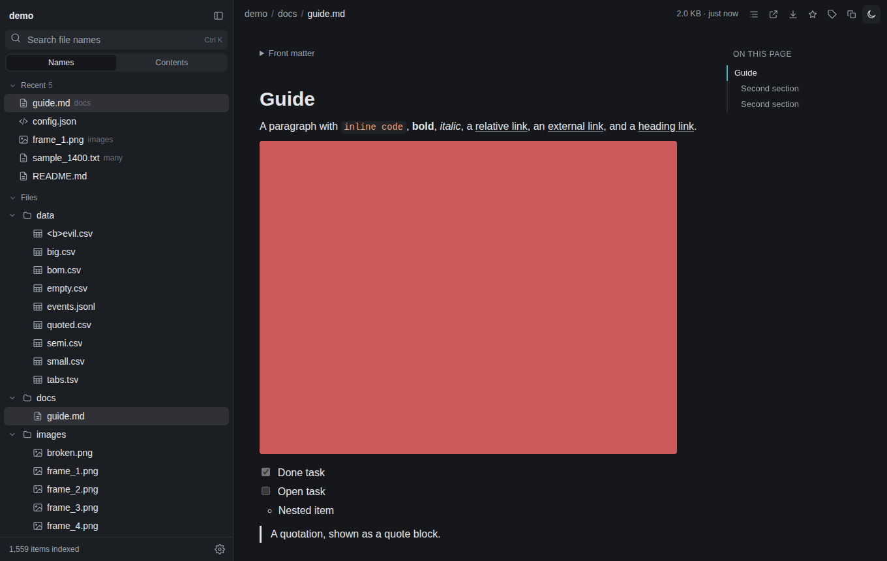
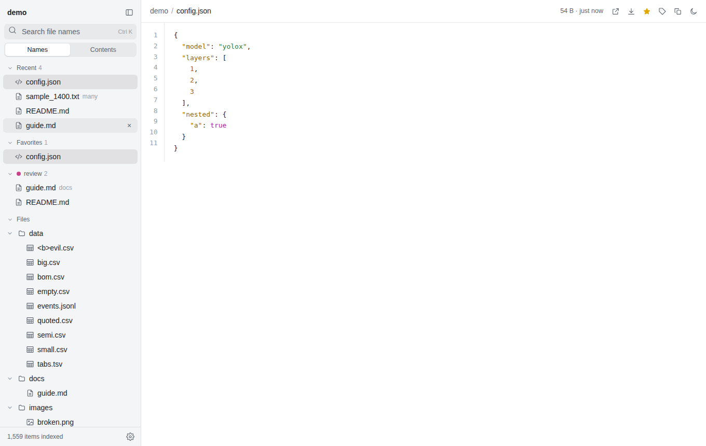
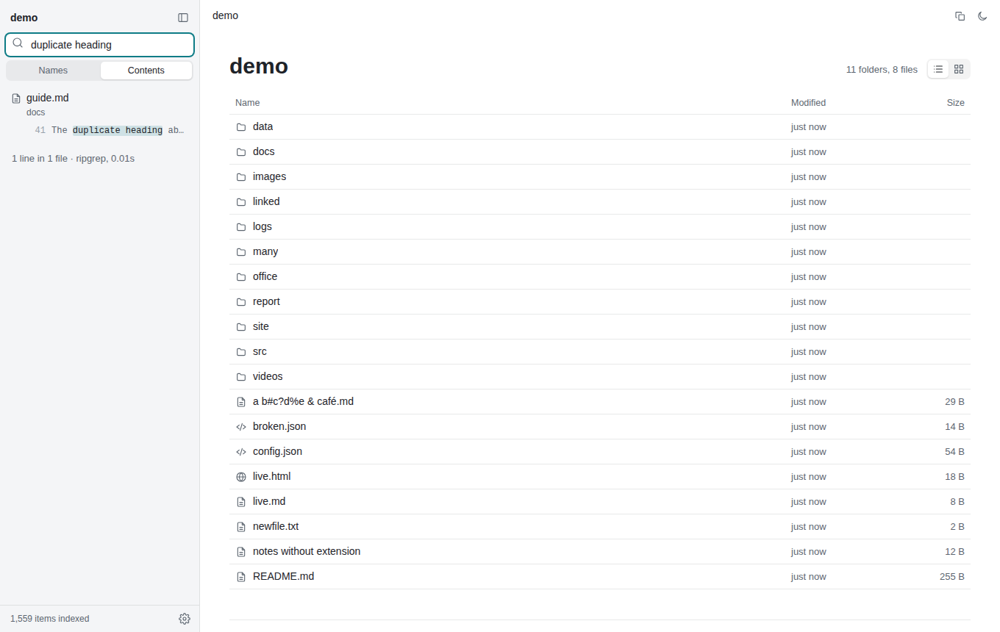
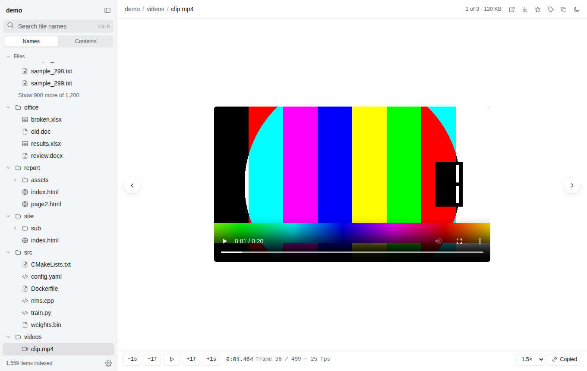
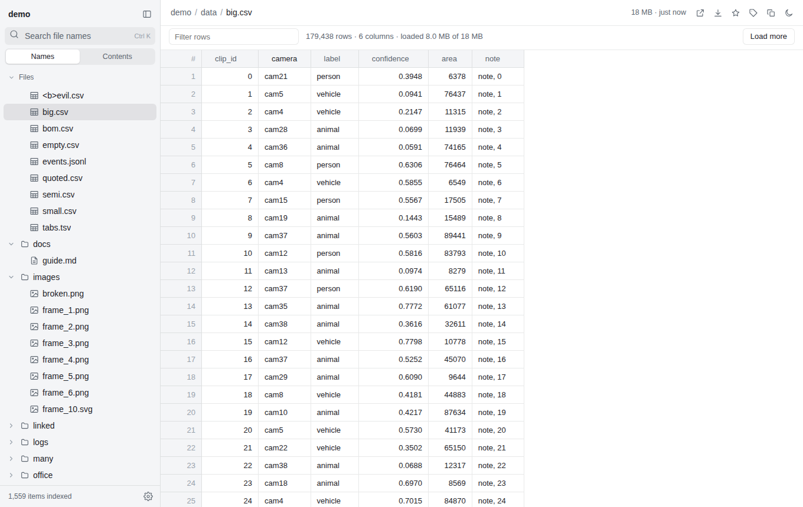
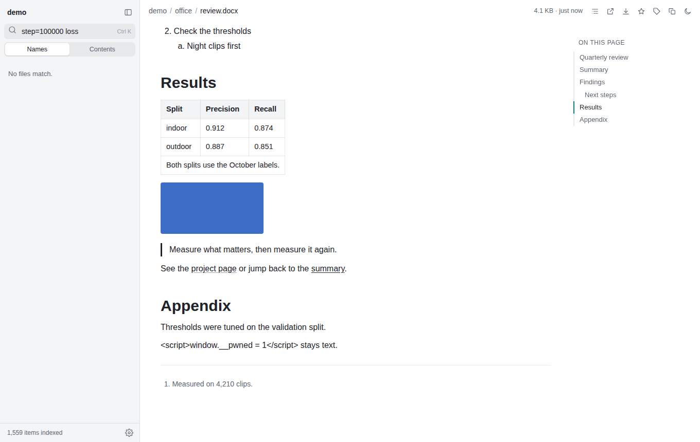
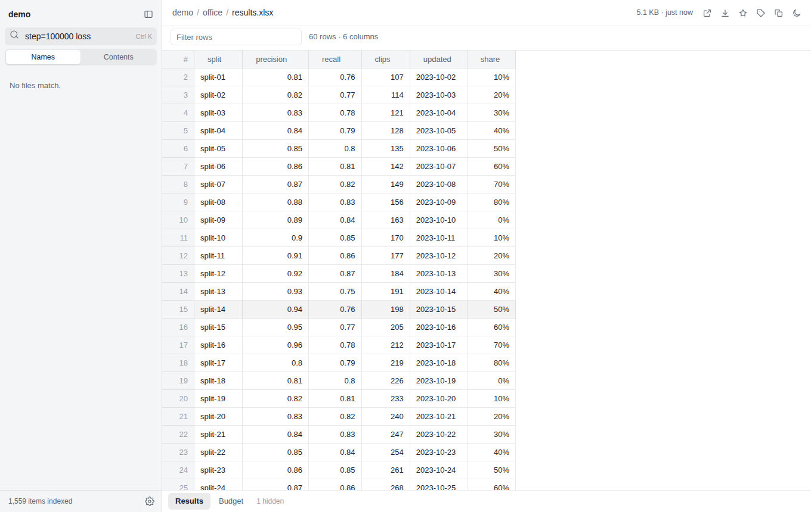
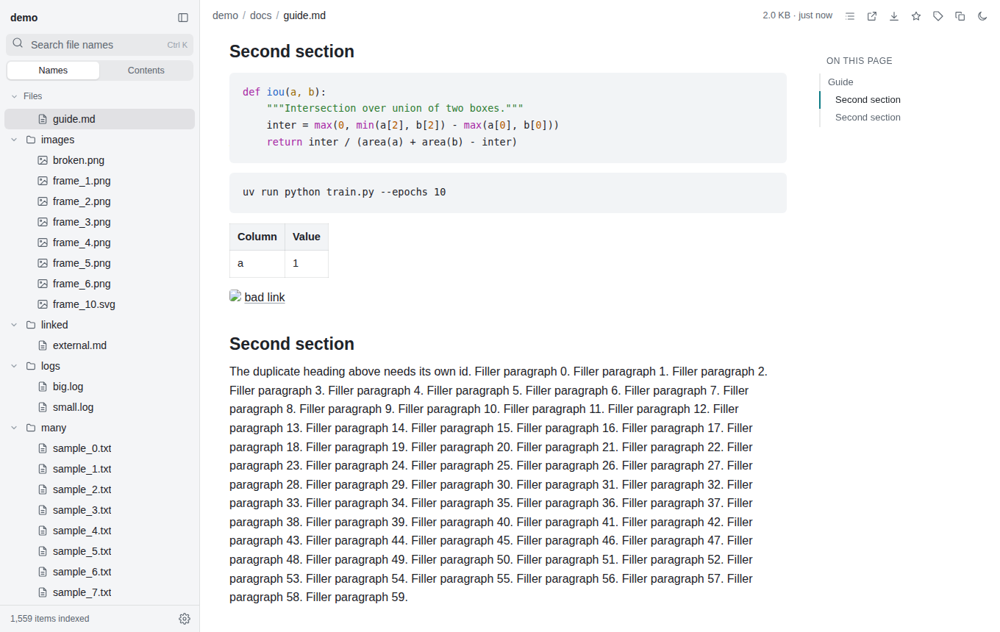
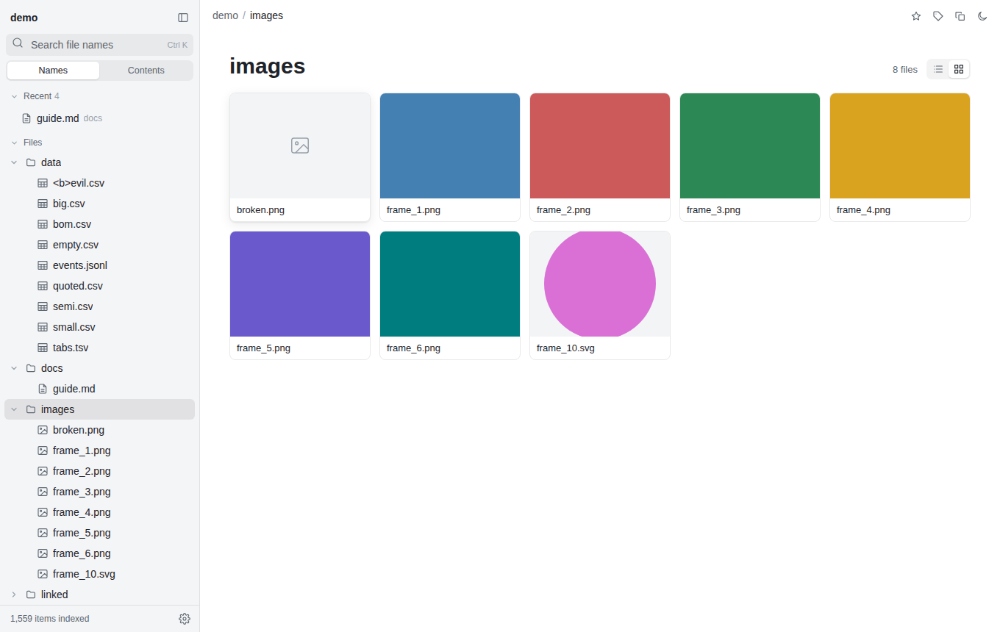

# Features

- [Layout](#layout)
- [Recent, favorites, and tags](#recent-favorites-and-tags)
- [What renders](#what-renders)
- [Search](#search)
- [Video review](#video-review)
- [Tables](#tables)
- [Word and Excel](#word-and-excel)
- [Markdown outline](#markdown-outline)
- [Galleries and thumbnails](#galleries-and-thumbnails)
- [Live reload](#live-reload)
- [Settings](#settings)
- [Keyboard shortcuts](#keyboard-shortcuts)
- [Links](#links)

## Layout

The sidebar holds the folder tree, search, and settings. It's resizable by
dragging its edge, and it hides with `Ctrl+\`. On phones it becomes a drawer.
The main pane renders whatever is selected, with a breadcrumb trail and actions
at the top: open the raw file, download, copy the full path on the server, and
switch the theme.

## Recent, favorites, and tags

The top of the sidebar holds your own shortcuts, above the folder tree:

- **Recent:** the last files you opened, newest first, showing 10 (shelf keeps
  50). Paging through a folder with `←` `→` doesn't count, so flipping through
  a gallery doesn't push everything else out. Hover a file and press × to drop
  it, or use **Clear** on the heading.
- **Favorites:** files or folders you star with ☆ in the top bar. Starring
  opens a small box where you can give the favorite a **nickname**, or just
  click away to keep the file name. A nickname becomes the main name in
  Favorites, with the full path to its right. Click the star again to rename
  or remove it, or hover the favorite in the sidebar and use ✎ or ×. Clearing
  the nickname goes back to the file name, and removing the favorite drops it.
- **One section per tag.** Tag anything with the tag button in the top bar:
  type a new tag and press Enter, or pick an existing one. A file can have any
  number of tags. They appear as chips in the top bar, and each tag gets its
  own sidebar section with a colored dot. Hover a tag's heading to rename it
  (renaming onto an existing tag merges them) or delete it. Deleting a tag
  never touches the files.

Every section collapses with its heading, including **Files** (the tree), and
the collapsed state is remembered. The whole sidebar scrolls as one, and the
heading of the section you're in sticks to the top. Deep in the tree, the
**Files** heading stays put, so you can collapse the tree and get back to your
shortcuts in one click. Opening something from Recent, Favorites, or a tag
doesn't scroll the sidebar away from the list you clicked in.

Sections appear only when they have something in them. A file that's been
deleted drops out of Recent, but stays in Favorites and tags, dimmed, in case
it comes back (an unmounted disk, say).

**Where they're kept.** On the server, in `~/.config/shelf/state/`, not in the
browser, so they follow you between your laptop and phone, and survive clearing
browser data. With [`--allow-user`](security.md), each Tailscale user has their
own lists. In token or open mode, everyone shares one set. They're stored per
served folder, and never in the folder itself.

## What renders

| Files | Viewer |
|---|---|
| `.md` | GitHub-flavored Markdown, with highlighted code blocks, copy buttons, tables, task lists, and front matter folded away. Relative links open in shelf, relative images load, and external links open in a new tab. |
| `.html` | The page itself, with its CSS, scripts, `fetch` calls, and relative assets working. Links inside the page update shelf's address bar. A folder containing `index.html` opens that page, as a web server would. |
| Images | Fit to the pane; click to view at full size; `←` `→` move between images in the folder. |
| Video and audio | The browser's player, with seeking and the [review tools](#video-review). |
| `.csv` `.tsv` | A [table](#tables). The delimiter is detected (`,` `;` tab `\|`). |
| `.jsonl` `.ndjson` | A [table](#tables), or highlighted text if you switch it off. |
| `.docx` | A page, like Markdown, with an outline. See [Word and Excel](#word-and-excel). |
| `.xlsx` | A [table](#tables) per sheet, with sheet tabs. See [Word and Excel](#word-and-excel). |
| `.json` | Pretty-printed and highlighted. |
| `.pdf` | The browser's PDF viewer. |
| Code, logs, text | Line numbers and syntax highlighting. Large files load 1 MB at a time. |
| Anything else | Sniffed: text shows as text; binary files get a download card. |

Video plays only in codecs the browser supports. H.265 and most `.mkv` and
`.avi` files show a download button, and with ffprobe installed, the message
names the codec.

## Search

The search box (`Ctrl+K`) has two modes.

**Names** matches file and folder names anywhere under the root as you type.
Every word must appear somewhere in the path, so `audit report html` finds
`experiments/audit/report/index.html`. Exact and prefix name matches rank
first. The index refreshes in the background when it's more than two minutes
old, and searching works while the first build is still running.

**Contents** (`Ctrl+Shift+F`) searches inside files, ignoring case. It uses
[ripgrep](https://github.com/BurntSushi/ripgrep) if it's installed and a Python
fallback if not. Results are grouped by file, with the matching line, its
number, and the match highlighted. Choosing a result opens the file there:

- **Text and code:** scrolled to the line, with the line marked.
- **Markdown:** the term highlighted, scrolled to the matching occurrence.
- **Tables:** the row filter pre-filled with the term.

Both modes skip dotfiles, `node_modules`, `__pycache__`, `site-packages`, and
`venv`. Content search also skips binary files, files over 64 MB (5 MB without
ripgrep), and stops after 300 matching lines or 12 seconds, saying so when it
does.

## Video review

Under every video is a bar for stepping through footage:

| Control | Key | Does |
|---|---|---|
| −1s / +1s | `J` / `L` (`Shift` for 5 s) | Seek |
| −1f / +1f | `,` / `.` | Step one frame, pausing first |
| ▶ | `Space` or `K` | Play or pause |
| Speed | `[` / `]` | 0.1× to 4× |
| Link | `T` | Copy a link that opens this video at this exact time |
| | `←` / `→` | Previous or next video in the folder |

The bar shows the time to the millisecond and the current frame number,
counted from 0. With ffprobe on the server it uses the file's real frame rate
and frame count. Without it, it measures the frame rate while the video plays
and marks it with `≈`.

## Tables

CSV, TSV, and JSONL open as a table that stays fast at any size:

- **Loading in pieces.** shelf reads 8 MB at a time and loads more as you
  scroll near the end. *Load more* fetches the next piece on demand.
- **Virtualized rows.** Only the rows on screen exist in the page, so 400,000
  rows scroll as smoothly as 40.
- **Sorting** by clicking a header (ascending, descending, off). Numbers sort
  as numbers, and blanks sort last.
- **Filtering** rows by any cell.
- **Pinned header** and row numbers. Number columns are right-aligned.

When a file is only partly loaded, sorting and filtering see only the loaded
rows, and the status line says so.

**JSONL:** each line's top-level keys become columns, in the order they first
appear. Nested values show as compact JSON, and lines that aren't valid JSON
keep their text in an `(unparsed line)` column. To see the raw lines instead,
use the text button in the top bar, which is remembered, or turn off
**JSONL files as tables** in Settings.

## Word and Excel

shelf reads Word and Excel files itself, using only Python's standard library.
The server doesn't need Office, LibreOffice, or any extra packages.

**Word (`.docx`, `.docm`, `.dotx`)** opens as a page in the same style as
Markdown, with the [outline](#markdown-outline) beside it. It shows:

- Headings, including numbered ones ("2.1 Method"), and paragraphs
- Bold, italic, underline, strikethrough, superscript and subscript
- Bulleted and numbered lists, nested, with their numbering
- Tables, with merged cells and header rows
- Embedded images (PNG, JPEG, GIF, BMP, WebP)
- Links. Links within the document jump in place.
- Footnotes and endnotes, listed at the end
- Quotes, captions, and code blocks, with a copy button

Fonts, colors, page layout, headers and footers, comments, text boxes, and
charts aren't shown. Neither are tracked deletions. Images in formats browsers
can't display (EMF, WMF, TIFF) show as a placeholder.

**Excel (`.xlsx`, `.xlsm`, `.xltx`)** opens in the [table viewer](#tables), so
it sorts and filters like a CSV:

- The first row is the header. Row numbers match Excel's, and hovering a
  header shows its column letter.
- A tab bar under the table switches sheets. Workbooks open on the sheet that
  was active when they were saved, and the sheet is in the URL (`?sheet=1`).
- Formulas show their last calculated values. Dates, times, and percentages
  are shown as dates, times, and percentages. Other numbers appear unformatted,
  so they sort correctly.
- Hidden sheets are left out of the tabs, with a count of how many there are.
- Up to 100,000 rows and 1,000 columns per sheet. Beyond that, the status
  line says what's shown.

Charts, pivot tables, cell formatting, and merged-cell layout aren't shown.

Older formats (`.doc`, `.xls`) and PowerPoint files show a download card
instead. Saving them as `.docx` or `.xlsx` makes them open in shelf. A file
that's damaged or password-protected gets a message saying so.

## Markdown outline

Markdown files with two or more headings get an **On this page** outline
beside them. It highlights the section you're reading, and clicking an entry
jumps to it. Toggle it with the outline button in the top bar or in Settings;
the choice is remembered. On narrow screens it opens as a panel over the page
instead.

## Galleries and thumbnails

A folder that's mostly images or videos opens as a gallery, and the toggle at
the top switches between list and gallery views per folder. With ffmpeg on the
server, shelf generates small thumbnails for large images and poster frames for
videos, and caches them in `~/.cache/shelf/thumbs`. Small images are sent as
they are. Without ffmpeg, galleries load full images, and videos show an icon.

## Live reload

The open file is checked every few seconds while the tab is visible, and
re-rendered when it changes, keeping your scroll position. So a report you're
regenerating, or a plan someone is editing, stays current. Rendered HTML
reloads in place. Files over 2 MB, such as a growing log, show a **Changed ·
Reload** button instead of reloading by themselves. Folders refresh their
listings the same way. Turn this off in Settings.

## Settings

The gear at the bottom of the sidebar opens Settings:

- **Theme:** System, Light, or Dark.
- **Outline beside Markdown.**
- **JSONL files as tables.**
- **Thumbnails in galleries.**
- **Reload files when they change on disk.**
- **Keyboard shortcuts:** the full list.
- **Access:** who you're signed in as, and sign out when using a token.

Settings, the sidebar width, open folders, collapsed sections, and the theme are
kept per browser in local storage. Recent files, favorites, and tags are kept
on the server, [as above](#recent-favorites-and-tags).

## Keyboard shortcuts

| Key | Does |
|---|---|
| `Ctrl/⌘ K` | Search names |
| `Ctrl/⌘ Shift F` | Search inside files |
| `↑` `↓` `Enter` `Esc` | Move through search results, open one, close search |
| `Ctrl/⌘ \` | Show or hide the sidebar |
| `←` `→` | Previous or next image or video |
| `Space` `K` `,` `.` `J` `L` `[` `]` `T` | [Video review](#video-review) |

## Links

Every view has its own URL, so you can bookmark it or send it to someone:

| URL | Opens |
|---|---|
| `/#/notes/plan.md` | A file in the app |
| `/#/logs/train.log?line=420` | A text file, scrolled to line 420 |
| `/#/notes/plan.md?q=threshold` | Markdown, with the term highlighted |
| `/#/clips/cam1.mp4?t=12.345` | A video at 12.345 seconds |
| `/notes/plan.md` | The raw file, as `http.server` would serve it |

Raw file URLs stay where `http.server` puts them, so `curl`, `wget`, and links
inside your own HTML keep working. Raw files support HTTP range requests, which
is what lets video seek.
